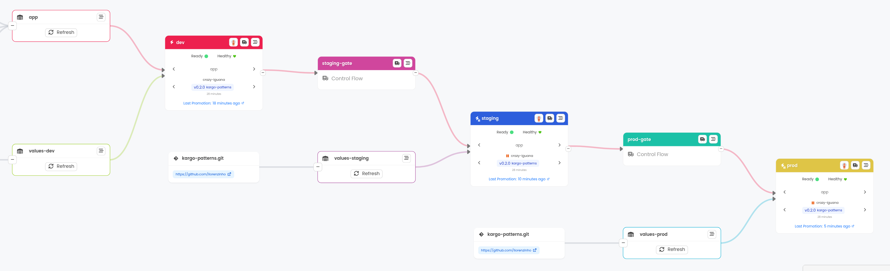
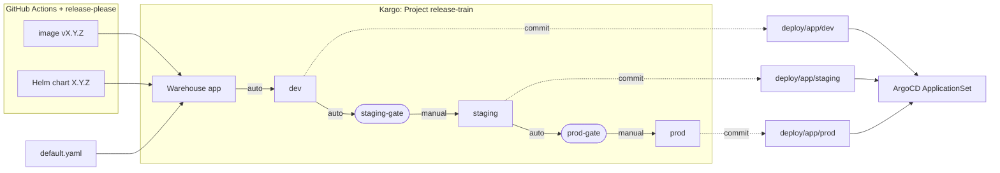
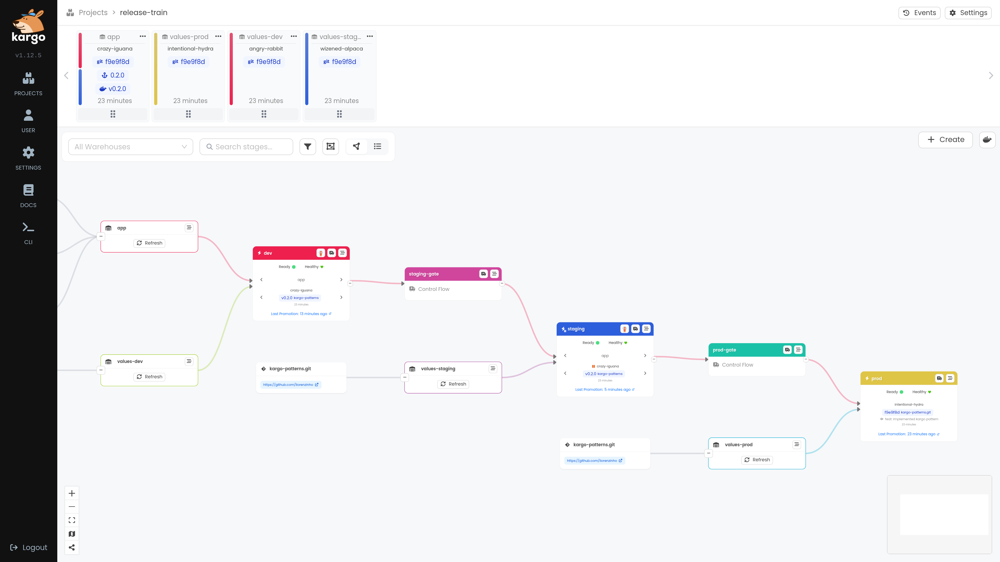
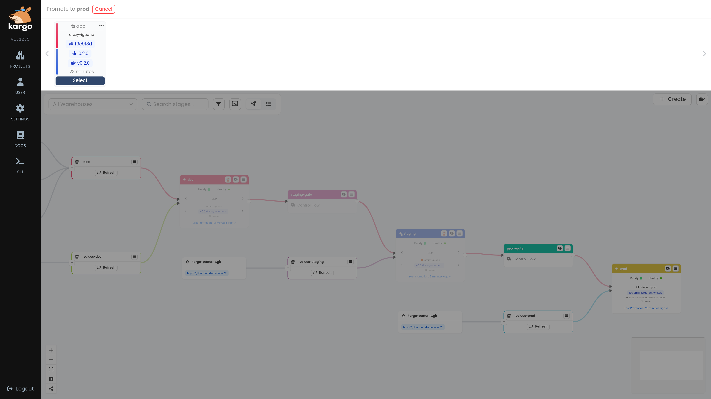
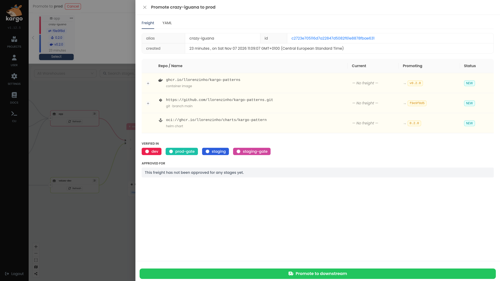
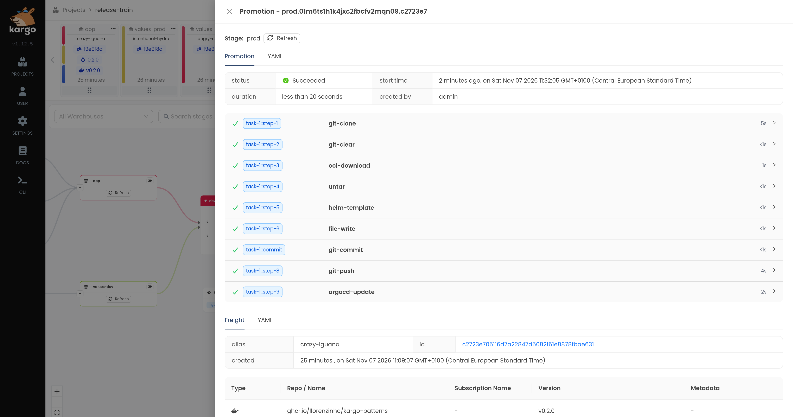
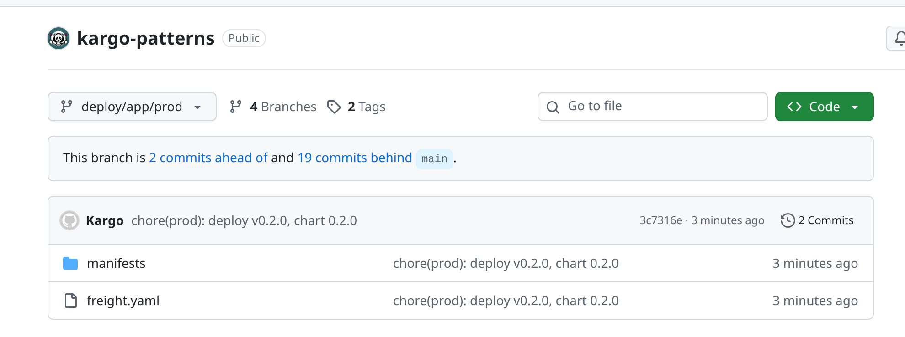
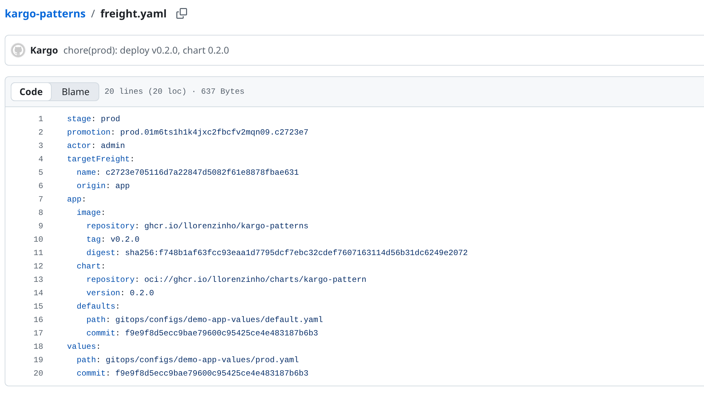
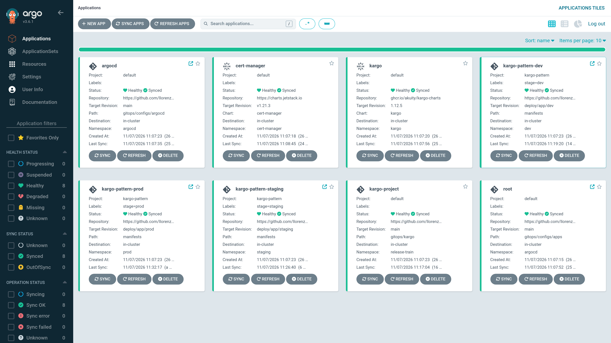
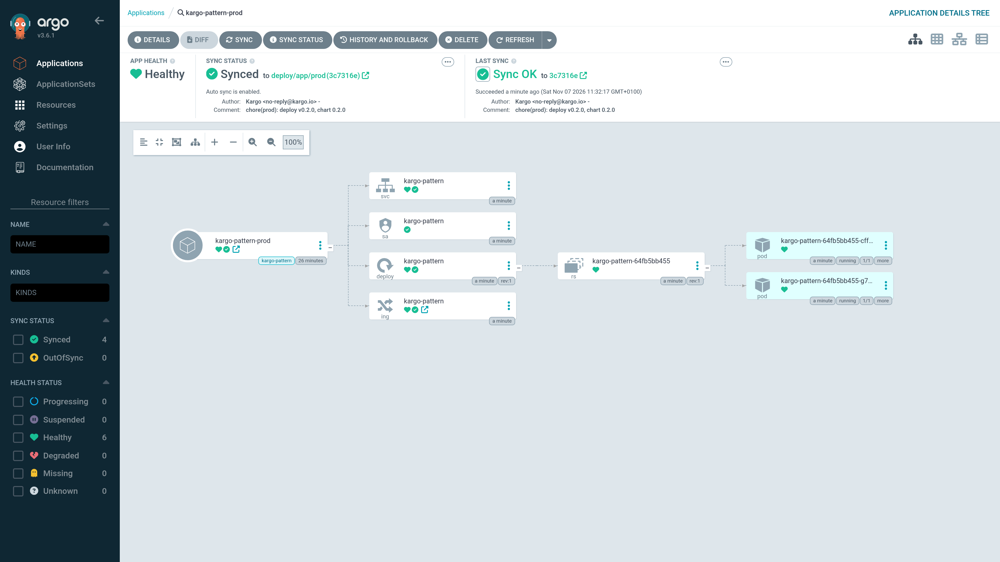

# kargo-pattern: a GitOps release train with Kargo and ArgoCD



A complete, reproducible promotion pipeline for a microservice. Every release flows
`dev → staging → prod` through Git, without a single `kubectl apply` or `helm install`
against an environment:

- **Release once, promote everywhere.** CI publishes a versioned image and Helm chart.
  [Kargo](https://kargo.akuity.io/) bundles them with their default configuration into
  one immutable unit, the *Freight*, and moves that unit from stage to stage.
- **Gates collect releases; humans decide.** Promotion to `dev` is automatic. Two gates
  collect everything that passed the previous stage, and a person promotes a release
  train from the gate into `staging` and `prod`.
- **Git is the deployment record.** Each promotion renders the chart and commits plain
  Kubernetes manifests, plus a manifest of what is deployed, to a branch per
  environment. ArgoCD deploys that branch.
- **One command to run it all.** `task up` starts a kind cluster with ArgoCD, which
  installs cert-manager, Kargo, the pipeline and the three environments.

The GitHub repository is `llorenzinho/kargo-patterns` (plural); the service, chart and
local cluster keep the `kargo-pattern` project name.

## How it works



| Piece | Role |
|---|---|
| release-please | Cuts independent releases of the app (`vX.Y.Z`) and the chart (`chart-vX.Y.Z`) |
| Warehouse `app` | Watches the image, the chart and `default.yaml`, and bundles them into Freight |
| Warehouses `values-<stage>` | Watch per-environment values; each one feeds a single stage and is never promoted |
| Stages `dev`, `staging`, `prod` | Render the chart and commit the result to `deploy/app/<stage>` |
| Gates `staging-gate`, `prod-gate` | Control flow stages: they hold every verified Freight for a manual promotion |
| ArgoCD ApplicationSet | Deploys `deploy/app/<stage>` into namespaces `dev`, `staging` and `prod` |

## A release, step by step

### 1. The train waits at the gate

A new release reached `dev` automatically and was verified there, so `staging-gate`
collected it. After its promotion to `staging`, `prod-gate` collected it too. `prod`
has not received it yet: nothing reaches production until someone promotes it.



### 2. Promote from the gate

The gate offers only Freight that has been verified upstream. Here the train carries
one release, `crazy-iguana`.



The Freight shows exactly what is about to ship: the image, the Helm chart and the
commit of the default configuration, promoted together. It also shows where the
release has already been verified: `dev`, `staging-gate`, `staging` and `prod-gate`.



### 3. The promotion renders and commits

One reusable `PromotionTask` does the work for every environment. It clones the
repository at the pinned commits, downloads the released chart, renders it with
`helm template`, writes the Freight manifest, commits, pushes and asks ArgoCD to sync.



### 4. Git records what is deployed

Each environment branch contains the rendered manifests and a `freight.yaml` that
records the deployed artifacts. Any commit on `deploy/app/prod` is a complete,
reviewable answer to "what is running in production?".





### 5. ArgoCD deploys it

ArgoCD manages itself, cert-manager, Kargo, the pipeline and the three environments
from this repository.



The production Application synced the commit Kargo just pushed:
`chore(prod): deploy v0.2.0, chart 0.2.0`.



### 6. The whole train is deployed


```console
$ curl http://kargo-pattern-prod.localhost:8080/version
{"commit":"f0f5e2fc7fa1e51080521a1433ba207cb0fd9f12","service":"kargo-pattern","version":"0.2.0"}
```

## Design decisions

- **Rendered manifests, not Helm at deploy time.** ArgoCD applies plain YAML. The diff
  of a promotion is the real change to the cluster, and rollback is a Git revert or a
  re-promotion of older Freight.
- **Artifacts and defaults travel together.** The image, the chart and `default.yaml`
  form a single Freight. Staging and production run exactly the combination that was
  verified before them.
- **Environment values never travel.** `dev.yaml`, `staging.yaml` and `prod.yaml` each
  have their own Warehouse, connected to one stage only. Values are versioned in
  Freight, so every render is reproducible.
- **Gates as control flow stages.** A gate has no promotion process: it only collects
  verified Freight. This keeps the human decision point explicit, and leaves room for
  more microservices to join the same train.
- **Manual promotion, enforced by the pipeline.** Kargo enables auto-promotion per
  stage, and `staging` and `prod` need it for their values. The release Freight stays
  manual because it uses the `MatchUpstream` selection policy, and a control flow gate
  never holds Freight.
- **No secrets in Git.** Admin and Git credentials are created by `task up` from local
  configuration.

## Try it

You need Docker, [mise](https://mise.jdx.dev/), a fork of this repository, and at least
one release of the app and the chart published as public GHCR packages.

```sh
mise trust && task setup
# .env: KARGO_GIT_USERNAME and KARGO_GIT_TOKEN, a token that can push to your fork
task up
```

`task up` creates the kind cluster, installs ingress-nginx and ArgoCD, lets ArgoCD
install everything else and prints the URLs and credentials:

| What | URL |
|---|---|
| ArgoCD | <http://argocd.localhost:8080> |
| Kargo | <http://kargo.localhost:8080> |
| dev / staging / prod | <http://kargo-pattern-dev.localhost:8080>, `-staging`, `-prod` |

Then promote a release train from a gate:

```sh
kargo login http://kargo.localhost:8080 --admin   # password: task kargo:password
kargo promote --project release-train --freight-alias <alias> --downstream-from staging-gate
```

ArgoCD and Kargo read from GitHub, not from your working tree: push `gitops/` before
running `task up`. Remove everything with `task cluster:delete`.

More detail: [`gitops/configs/README.md`](gitops/configs/README.md) covers the
installation, and [`gitops/kargo/README.md`](gitops/kargo/README.md) covers the
pipeline.

## Repository layout

| Path | Contents |
|---|---|
| `app/` | Small Go HTTP service with structured JSON logs |
| `chart/` | Helm chart for the service, published as an OCI artifact |
| `gitops/configs/` | ArgoCD installation, app-of-apps root, Kargo installation, ApplicationSet, and per-environment values in `demo-app-values/` |
| `gitops/kargo/` | The release-train pipeline: Project, Warehouses, Stages and PromotionTask |
| `.github/workflows/` | CI, release-please, image and chart publishing |

Built with Kargo v1.12.5, ArgoCD v3.6.1, cert-manager, ingress-nginx and kind.

---

## Reference

### Service

| Endpoint | Description |
|---|---|
| `GET /` | Hello response with service and version |
| `GET /healthz` | Liveness probe |
| `GET /readyz` | Readiness probe |
| `GET /version` | Service, version and commit |

Every log record is JSON and includes the service build metadata:

```json
{"time":"2026-11-06T12:00:00Z","level":"INFO","msg":"http request","service":"kargo-pattern","version":"0.1.0","commit":"abc1234","method":"GET","path":"/version","status":200}
```

| Variable | Default | Description |
|---|---|---|
| `PORT` | `8080` | HTTP port |
| `LOG_LEVEL` | `info` | `debug`, `info`, `warn` or `error` |

### Requirements

- Docker Engine or Docker Desktop running locally
- [mise](https://mise.jdx.dev/)

`mise.toml` pins Go, kind, kubectl, Helm, kustomize, Task, pre-commit, Docker CLI,
golangci-lint, actionlint, ArgoCD CLI, Kargo CLI, yq and jq. mise installs the Docker
**CLI**, not the Docker daemon.

### Run the service locally

```sh
mise trust
task setup
task doctor
task app:run
curl http://localhost:8080/version
```

### Chart only on kind

`task e2e` creates the kind cluster, builds and loads the image, installs ingress-nginx
and the chart, and checks `http://kargo-pattern.localhost:8080/version`. It does not
install ArgoCD or Kargo.

### Troubleshooting: kube-proxy crash loops

kind nodes share the host inotify limits. With the common default
`fs.inotify.max_user_instances=128`, `kube-proxy` crash-loops with
`fsnotify watcher init: too many open files`, no Service VIPs are programmed and every
pod fails to reach the API server. `task cluster:create` raises the limits inside the
privileged kind node; to change them host-wide instead:

```sh
sudo sysctl -w fs.inotify.max_user_instances=1024 fs.inotify.max_user_watches=524288
```

### Helm chart

The chart creates a ServiceAccount, Deployment, Service and optional Ingress. The
default image tag is `Chart.AppVersion`; pass `image.tag` explicitly, because the chart
and the application are released independently.

```sh
helm install kargo-pattern \
  oci://ghcr.io/llorenzinho/charts/kargo-pattern \
  --version 0.2.0 \
  --set image.tag=v0.2.0
```

### CI/CD

- `ci.yml`: pre-commit, Go checks, Helm lint and template, GitOps manifest rendering
  and image build
- `release-please.yml`: release PRs and tags for `app` and `chart`
- `image.yml`: builds and pushes `ghcr.io/<owner>/kargo-patterns` only for release tags
  (`v*`) or when called by `release-please.yml`
- `chart-publish.yml`: packages the chart, pushes it to `oci://ghcr.io/<owner>/charts`
  and attaches the `.tgz` to the GitHub release

| Path changed | Release tag | Artifact |
|---|---|---|
| `app/` | `vX.Y.Z` | `ghcr.io/<owner>/kargo-patterns:vX.Y.Z` |
| `chart/` | `chart-vX.Y.Z` | `oci://ghcr.io/<owner>/charts/kargo-pattern:X.Y.Z` |

Commits follow [Conventional Commits](https://www.conventionalcommits.org/), validated
locally by the commit-msg hook. GHCR packages are private by default: after the first
push, set their visibility to **public**.

The default `GITHUB_TOKEN` cannot trigger other workflows from the release PR. To also
run CI on release PRs, store a fine-grained token with `contents: write` and
`pull-requests: write` as the `RELEASE_PLEASE_TOKEN` repository secret.
